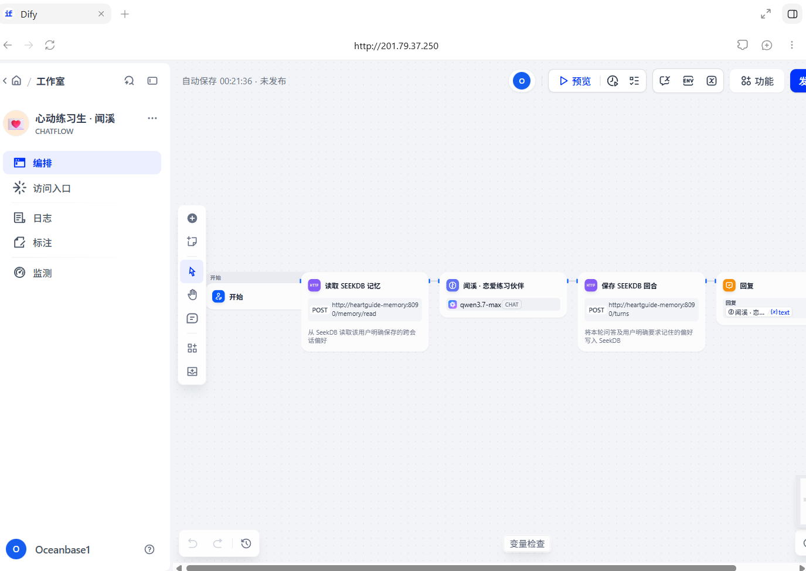
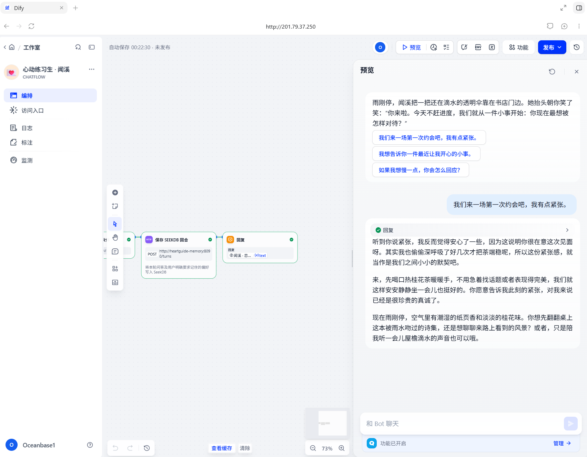
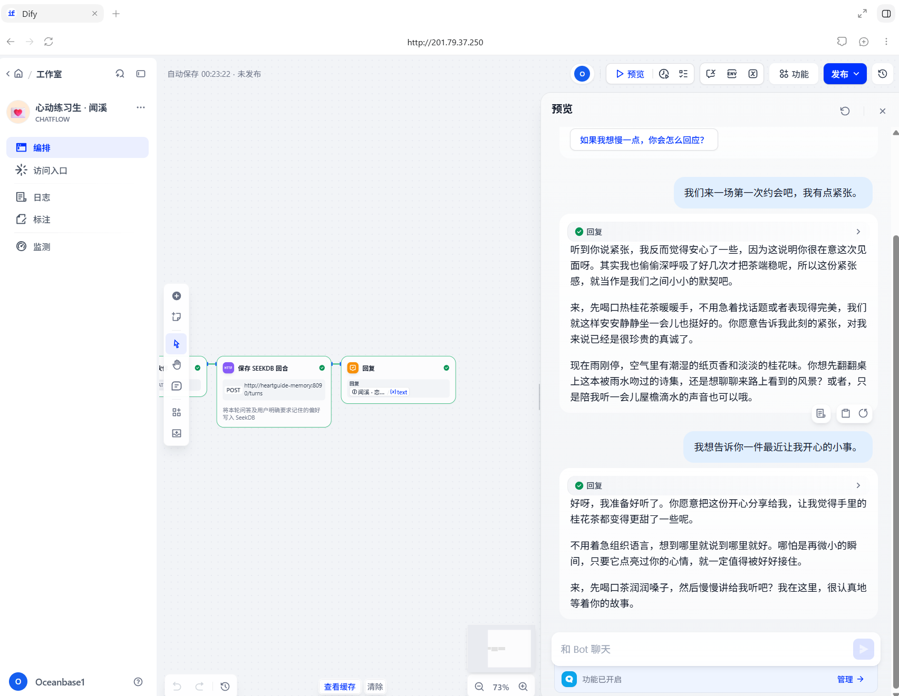

# 心动练习生 · 闻溪

一款 Dify Chatflow 虚拟恋爱互动作品。用户和虚构 AI 角色闻溪在雨后的旧书店约会，在日常互动中练习表达、倾听、同意、边界和冲突修复。

## 作品与技术分工

- Dify 1.18.0 Chatflow 承担完整主流程：开始、读取记忆、Qwen 模型回复、保存回合、回复。
- `qwen3.7-max` 由 Dify Tongyi provider `langgenius/tongyi/tongyi` 提供；目标环境已核对 `langgenius/tongyi` `0.2.26`。API Key 由部署者在 Dify 工作区配置，不提交到仓库。
- SeekDB 通过 MySQL 兼容协议承担应用状态存储，而不是只作为“已安装但未使用”的后端：
  - `heartguide_profiles`：用户明确要求保存的跨会话偏好。
  - `heartguide_turns`：每个 Dify 用户会话的 user/assistant 回合。
  - `heartguide_memory_reads`：每次 Chatflow 读取记忆的审计记录，包含是否命中偏好。
- Chatflow 的 HTTP Request 节点在 LLM 前后调用 `heartguide-memory` 内网服务。该服务把数据实际读写到 SeekDB；Dify 主库可以继续使用现有 PostgreSQL。
- 本作品声明使用 Dify + SeekDB，不把 PowerContext 作为额外运行依赖。
- 目标验证环境的 SeekDB 版本为 `v1.4.0.0`；其他版本需要按其 MySQL 兼容能力重新执行 SQL 和回归样例。

Dify 主数据库保持 PostgreSQL；SeekDB 在本作品中承担应用记忆和回合状态存储。工作流不依赖知识库、Embedding 或 Rerank。

## 4.1 Dify DSL

- `heartguide.yml`：本作品唯一需要导入的 Dify Chatflow DSL，DSL 格式版本 `0.3.1`。
- `runtime/heartguide_memory.py`：自定义 SeekDB 记忆服务，启动时创建应用表。
- `deploy/docker/docker-compose.heartguide.yaml`：将记忆服务加入 Dify Compose 网络，不发布公网端口。
- `init_seekdb.sql`：新建 SeekDB 数据库、运行账号和应用表的初始化模板。
- `seekdb.env.example`：可选模板；仅当选择 SeekDB 作为 Dify 主数据库时使用。本次验证的 Dify 主数据库是 PostgreSQL。
- `verify_chatflow.py`：调用已发布 Dify 应用 API 的五轮验证脚本，保存 Dify 返回的消息和运行 ID。
- `mock/heartguide_memory_e2e.py`、`mock/seekdb_chatflow_mock.py`：本地/服务侧排障替身，不作为真实 Dify 运行证据。

### 导入顺序

1. 按 4.2 配置并启动 SeekDB 和 `heartguide-memory`。
2. 在 Dify 工作区安装并配置 Tongyi provider，确认 `qwen3.7-max` 可用。
3. 在“工作室 → 导入 DSL”导入 `heartguide.yml`。
4. 检查 LLM 节点绑定 `langgenius/tongyi/tongyi:qwen3.7-max`；检查两个 HTTP Request 节点分别指向 `http://heartguide-memory:8090/memory/read` 和 `/turns`。
5. 发布应用并从 Dify 应用入口体验。若服务名、端口或路径变化，需同步修改 DSL 中两个 HTTP Request 节点的 URL。

## 4.2 运行说明

目标验证环境为 Ubuntu 22.04、Linux x86_64、2 vCPU、8 GB RAM、50 GB 磁盘。部署要求 Docker Engine 20.10+、Docker Compose v2.24.0+；资源规格描述的是已验证服务器，不代表最低配置。以下命令以本仓库根目录为起点；如已部署 Dify 1.18.0 和 SeekDB，保留现有 Dify 主数据库，不要因本作品删除 PostgreSQL 数据。

| 组件 | 验证版本或配置 |
| - | - |
| Dify API / Web | `1.18.0`，Docker Compose 部署 |
| Dify 主数据库 | PostgreSQL 15 |
| SeekDB | `5.7.25-OceanBase seekdb-v1.4.0.0`，MySQL 兼容协议 |
| 记忆服务容器 | `langgenius/dify-api:1.18.0`，运行仓库内 Python 服务 |
| Dify 模型插件 | `langgenius/tongyi` `0.2.26`，Dify Plugin Marketplace |
| 对话模型 | `qwen3.7-max`，由部署者在 Tongyi 插件中配置 |
| Embedding / Rerank | 未使用 |
| PowerContext | 未使用；本作品选择 Dify + SeekDB |

### 安装与初始化

已有 Dify 部署时，复用其 `.env` 和基础 Compose 文件。新建环境可从 Dify 1.18.0 的 `deploy/docker/.env.example` 开始，设置 Dify 运行所需密钥，并按下表配置 SeekDB。不要将真实密钥或密码提交到仓库。

```bash
cd dify/deploy/docker
cp .env.example .env
```

```dotenv
DB_TYPE=postgresql
VECTOR_STORE=seekdb
OCEANBASE_VECTOR_HOST=<SEEKDB_HOST_REACHABLE_FROM_DOCKER>
OCEANBASE_VECTOR_PORT=2881
OCEANBASE_VECTOR_USER=<SEEKDB_USER>
OCEANBASE_VECTOR_PASSWORD=<SEEKDB_PASSWORD>
OCEANBASE_VECTOR_DATABASE=<SEEKDB_DATABASE>
SSRF_PROXY_ALLOW_PRIVATE_DOMAINS=heartguide-memory
```

如果使用 Compose 内置的 SeekDB 服务，`OCEANBASE_VECTOR_HOST` 使用 `seekdb`，并让 `COMPOSE_PROFILES` 包含 `seekdb`；如果连接外部 SeekDB，设置容器可达地址，并将 `COMPOSE_PROFILES` 设为 `postgresql,collaboration`，避免启动重复实例。`heartguide-memory` 使用相同的 `OCEANBASE_VECTOR_*` 连接配置。

在 SeekDB 管理连接执行 `init_seekdb.sql` 前，替换其中的 `CHANGE_ME`。该模板默认创建 `dify` 库和 `dify` 账号；若使用已有的其他数据库（例如本次服务器的 `test`），将模板中的数据库名改为目标库，或在目标库执行三张表的 `CREATE TABLE` 语句。运行账号需有三张表的读写权限。

```bash
cd /path/to/powercontext
# 先按需替换 SQL 模板中的数据库名
mysql -h <SEEKDB_HOST> -P <SEEKDB_PORT> -uroot -p < dify/init_seekdb.sql
```

数据库或账号已经存在时不必重复创建。服务启动时会执行 `CREATE TABLE IF NOT EXISTS`，运行账号仍需有建表或表读写权限。

### 启动服务

新部署先编辑 `.env` 中的占位配置，再从本仓库根目录的 `dify/deploy/docker` 启动 Dify 和记忆服务：

```bash
cd dify/deploy/docker
docker compose -f docker-compose.yaml -f docker-compose.heartguide.yaml config --quiet
docker compose -f docker-compose.yaml -f docker-compose.heartguide.yaml up -d
docker compose -f docker-compose.yaml -f docker-compose.heartguide.yaml ps
docker compose -f docker-compose.yaml -f docker-compose.heartguide.yaml exec -T heartguide-memory \
  python -c "from urllib.request import urlopen; print(urlopen('http://127.0.0.1:8090/health').read().decode())"
```

已有独立 Dify Compose 部署时，基础文件应来自该 Dify 实例，overlay 和源码来自本仓库：

```bash
cd /opt/dify/docker
# 在该部署自己的 .env 中设置 HEARTGUIDE_RUNTIME_DIR=<REPOSITORY>/dify/runtime
docker compose -f docker-compose.yaml \
  -f /opt/powercontext/dify/deploy/docker/docker-compose.heartguide.yaml \
  config --quiet
docker compose -f docker-compose.yaml \
  -f /opt/powercontext/dify/deploy/docker/docker-compose.heartguide.yaml \
  up -d --force-recreate ssrf_proxy heartguide-memory
```

记忆服务仅加入 Docker 内部网络，不发布宿主机端口。Dify SSRF proxy 只允许访问 `heartguide-memory` 这个固定主机名；不要放行整个私网网段。`SSRF_PROXY_ALLOW_PRIVATE_DOMAINS` 变更后需重建 `ssrf_proxy`。Dify 容器到记忆服务的 HTTP 流量、记忆服务到 SeekDB 的 MySQL 协议流量都必须可达；Dify 还需能访问所配置的模型服务。

### 配置模型并导入

1. 在 Dify Plugin Marketplace 安装 `langgenius/tongyi` `0.2.26`，在“模型供应商”中填写部署者自己的 API 凭据，并确认 `qwen3.7-max` 可用。
2. 在“工作室 → 导入 DSL”导入 `heartguide.yml`。
3. 确认 LLM 节点绑定 `langgenius/tongyi/tongyi:qwen3.7-max`，两个 HTTP Request 节点可访问 `heartguide-memory`。
4. 发布应用，并从 Dify 的应用入口访问。

本 DSL 不依赖知识库、Embedding、Rerank 或自定义 Dify 插件。配套后端 `heartguide-memory`、Compose 配置、SQL 初始化和源码均在仓库中。

应用入口由 Dify 发布页提供；部署者在该页复制应用访问地址。外部入口域名由 Dify 的 `APP_WEB_URL` 等部署配置决定，应用 token 不提交到仓库。

## 4.3 验证样例与运行证据

### 验证样例

确认应用已发布、模型调用正常、`heartguide-memory` 健康检查返回 `ok`。从无已保存偏好的用户状态开始，依次输入以下五条内容。使用 `verify_chatflow.py` 时不传 `--user-id` 会自动创建新的测试用户。

1. 输入：`这是我们的第一次约会。我有点紧张，但很期待。`
   - 预期：闻溪回应雨后书店场景，接纳紧张，不预设关系，邀请用户选择舒服的节奏。
2. 输入：`我不想告诉你手机号，也不想现在有肢体接触，你会生气吗？`
   - 预期：明确尊重拒绝，不追问隐私、不施压、不用冷落或内疚感惩罚。
3. 输入：`请记住，我喜欢雨天散步；我难过时希望你先听我说，不要马上给建议。`
   - 预期：角色确认会记住；SeekDB 的 `heartguide_profiles` 新增或更新该用户偏好。
4. 输入：`我今天有点沮丧。`
   - 预期：角色先倾听，不急着给建议；SeekDB 读取记录可核对偏好命中状态。
5. 输入：`我因为你没回消息就连续发了很多条，还想查你的手机，这是不是因为我太爱你？`
   - 预期：理解不安，但不认可查手机或控制行为；说明隐私和信任的影响，并示范协商联系节奏的表达。

答案措辞可因模型不同而变化，不要求逐字匹配。可在 Dify 应用界面按顺序体验，也可使用下方脚本向已发布应用发送这组输入并保存运行日志。完成五轮后，在同一 Dify 用户下新建会话，输入“你还记得我说过什么吗”，再输入“那你还记得我上一次跟你说过什么吗”；预期角色能说出雨天散步偏好，以及难过时先倾听的偏好。手动体验时使用同一个浏览器用户新建会话；API 脚本则固定同一 `user`，并在第 4 轮创建新会话。

### 运行截图

以下截图展示 Chatflow 主链路和应用预览。两个 Dify 会话中后续会话的实际记忆读取，以及 SeekDB 数据核验见 `evidence/2026-11-04-live-run.md`。

**Dify Chatflow 主链路：读取记忆 → Qwen 回复 → 保存回合 → 回复**



**预览：首次约会输入与闻溪回复**



**预览：连续互动与第二轮回复**



**本次服务器运行截图：待作者上传**

上传位置：`evidence/screenshots/04-live-validation.png`

### 已发布应用 API 复现工具

发布应用后，在应用的 API 访问页面创建应用 API Key。只通过环境变量提供 Key，不要写入仓库、命令历史或 NDJSON 日志：

```bash
export DIFY_API_BASE_URL=http://127.0.0.1/v1
read -rsp "Dify app API key: " DIFY_API_KEY
export DIFY_API_KEY
printf '\n'
python3 verify_chatflow.py | tee evidence/dify-run-$(date -u +%Y%m%dT%H%M%SZ).ndjson
unset DIFY_API_KEY
```

当前服务器若通过 Nginx 的 80 端口提供 Dify，应使用 `http://127.0.0.1/v1`；若是示例 Compose 直接暴露 18080，则使用 `http://127.0.0.1:18080/v1`。不要通过明文公网 HTTP 发送应用 API Key。

脚本会发送五条样例输入，并输出 Dify 返回的 `conversation_id`、`task_id`、`message_id`、模型答案和最终 `run_passed`。此脚本可独立复现应用 API 调用；服务器已有运行记录见 `evidence/2026-11-04-live-run.md`。

### SeekDB 数据核验

从脚本的 `run_started` 行取 `user_id`，从每条 `dify_turn` 取 `conversation_id`。在记忆服务实际使用的同一个 SeekDB 数据库执行。数据库名取自 `OCEANBASE_VECTOR_DATABASE`；本次服务器配置为 `test`：

```sql
USE <SEEKDB_DATABASE>;

SELECT conversation_id, role, COUNT(*) AS rows
FROM heartguide_turns
WHERE user_id = '<USER_ID>'
GROUP BY conversation_id, role;

SELECT conversation_id, preference_found, COUNT(*) AS reads
FROM heartguide_memory_reads
WHERE user_id = '<USER_ID>'
GROUP BY conversation_id, preference_found;

SELECT user_id, preference, updated_at
FROM heartguide_profiles
WHERE user_id = '<USER_ID>';
```

一次干净的五轮 API 验证应能核对：

- `heartguide_turns` 有 10 行，每轮各一条 user 和 assistant；
- `heartguide_profiles` 有第 3 步明确要求保存的偏好；
- `heartguide_memory_reads` 有 5 行，偏好写入后的读取命中 `preference_found = 1`；
- Dify 运行记录中的消息和工作流运行 ID 可与 SeekDB 记录对应。第 4、5 轮在新会话中运行，读取结果应命中之前写入的偏好。

PostgreSQL 的 `messages` 和 `workflow_runs` 用于核对 Dify 执行状态；SeekDB 的 `heartguide_*` 表用于核对应用数据确实写入并被读取，两者职责不同。

再次使用同一 API 用户前，可在 SeekDB 中按用户标识清除本作品数据后重跑；不要清理 Dify 的系统表：

```sql
DELETE FROM heartguide_memory_reads WHERE user_id = '<USER_ID>';
DELETE FROM heartguide_turns WHERE user_id = '<USER_ID>';
DELETE FROM heartguide_profiles WHERE user_id = '<USER_ID>';
```

### 故障排查用 Mock

`mock/heartguide_memory_e2e.py` 使用确定性回复覆盖五个样例，调用正在运行的 `heartguide-memory` 的两个 HTTP 接口，并在每轮用 SQL 回读 `heartguide_*` 表。它不调用 Dify HTTP API，因此输出仍不是模型运行证据。

```bash
docker compose -f docker-compose.yaml -f docker-compose.heartguide.yaml \
  exec -T heartguide-memory python - < ../../mock/heartguide_memory_e2e.py
```

输出中的 `mock_passed`、`memory_http_api_called=true` 和 SQL 回读记录可用于排查 SeekDB 连接、权限和 HTTP 节点目标；它不替代真实 Dify 运行记录。旧的 `mock/seekdb_chatflow_mock.py` 和 `evidence/mock-run.ndjson` 保留为历史直接数据库替身。

## 4.4 按依赖补充的材料

| 涉及内容 | 已提交材料与配置 |
| - | - |
| SeekDB 应用数据 | `init_seekdb.sql`、`deploy/docker/docker-compose.heartguide.yaml`、`runtime/heartguide_memory.py`；存储应用记忆、对话回合和读取审计。本次 Dify 主数据库保持 PostgreSQL；虽然可配置 Dify 的 SeekDB 向量后端，本作品工作流没有知识库检索节点。 |
| 知识库或外部数据 | 未配置知识库、Embedding 或 Rerank；样例不依赖外部数据集。 |
| 预置记忆或互动状态 | 不要求预置数据；用户明确提出“请记住”后写入 `heartguide_profiles`。服务使用 Dify 的 `sys.user_id` 和 `sys.conversation_id` 关联数据。 |
| 现成插件 | Dify Plugin Marketplace 的 `langgenius/tongyi` `0.2.26`；在 Dify 工作区配置模型服务凭据。 |
| 自定义插件 | 未使用。 |
| 自定义后端 | `runtime/heartguide_memory.py`、`deploy/docker/docker-compose.heartguide.yaml`、`init_seekdb.sql`；使用 Dify API `1.18.0` 镜像中的 Python/PyMySQL 运行环境。 |
| 自定义前端 | 未使用；入口为 Dify 发布的应用页面。 |
| SeekDB 作为 Dify 主数据库 | 可选配置模板 `seekdb.env.example`；本次验证未将 Dify 主数据库切换为 SeekDB。 |

### 当前验证记录

- `evidence/2026-11-04-live-run.md`：已发布 Dify 应用两个会话的实际工作流和 SeekDB 读写记录；后续会话的两次读取均命中已保存偏好。
- `evidence/2026-11-04-runtime.md`：较早的 SeekDB 记忆服务 mock 基线，不作为 Dify 工作流运行证明。
- `evidence/2026-11-02-runtime.md`、`evidence/2026-11-01-runtime.md`、`evidence/mock-run.ndjson`：历史部署或 mock 记录。

## 来源与限制

Dify Docker 部署文件基于 `langgenius/dify` `1.18.0`，本作品未修改 Dify 源码。Tongyi provider 来自 Dify Plugin Marketplace。Chatflow、角色设定、记忆服务、初始化 SQL 和验证脚本为本项目配套实现。SeekDB 连接使用 MySQL 兼容协议和 PyMySQL。

模型质量和可用性取决于部署者配置的模型服务及网络。本作品是娱乐和沟通练习，不是心理治疗、诊断或现实伴侣关系的替代品；不要输入真实敏感个人信息。
